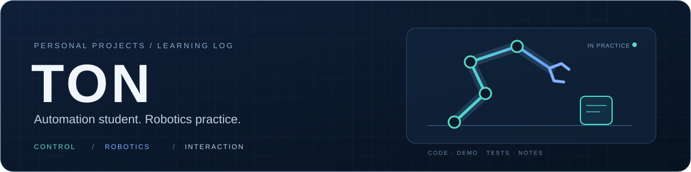

**自动化专业在读 · 控制逻辑 · 机器人实践 · 交互作品**

[电机互锁在线实验](https://ton242678-glitch.github.io/motor-interlock-lab/)　·　[纸飞机在线试玩](https://ton242678-glitch.github.io/paper-flight-battle/)　·　[全部仓库](https://github.com/ton242678-glitch?tab=repositories)

## 关于我

你好，我是 **Ton**，自动化专业学生。这里记录课程之外的编程练习、机器人相关实践和开源项目改进。

有 C 语言与 STM32 基础，正在积累 Python、JavaScript / TypeScript 和工程测试经验；参与过 OpenViTac 相关真机与仿真实践。希望把学习中的具体问题做成能运行、能解释、能核对结果的小项目。

## 重点项目

<table>
<tr>
<td width="50%" valign="top">

<h3>01　电机互锁实验</h3>

<strong>控制逻辑与交互演示</strong>

在浏览器中观察正反转互锁、方向冲突和急停恢复。控制模型与界面分离，支持操作记录与 CSV 导出。

<code>JavaScript</code> <code>State Machine</code> <code>Testing</code>

<a href="https://ton242678-glitch.github.io/motor-interlock-lab/">在线体验</a> · <a href="https://github.com/ton242678-glitch/motor-interlock-lab">查看代码</a> · <a href="https://github.com/ton242678-glitch/motor-interlock-lab/actions">验证记录</a>

</td>
<td width="50%" valign="top">

<h3>02　OpenViTac 实践</h3>

<strong>机器人真机与仿真方向</strong>

参与方向为真机与仿真实践。资料仓库整理视触觉任务、论文导读和运行参考，官方代码另存 Fork。

<code>Robotics</code> <code>Visuo-Tactile</code> <code>Simulation</code>

<a href="https://github.com/ton242678-glitch/openvitac-practice">实践资料</a> · <a href="https://github.com/ton242678-glitch/openvitac">源码 Fork</a> · <a href="https://fvl-repo.github.io/OpenViTac/">项目官网</a>

</td>
</tr>
<tr>
<td width="50%" valign="top">

<h3>03　StarVLA 通信扩展</h3>

<strong>基于开源项目的工程改进</strong>

围绕等待超时、连接级代理与请求容错改进通信流程，提供无需模型权重的本地 WebSocket 演示。

<code>Python</code> <code>WebSocket</code> <code>CI</code>

<a href="https://github.com/ton242678-glitch/starvla-deploy-kit">查看代码</a> · <a href="https://github.com/ton242678-glitch/starvla-deploy-kit/blob/starVLA_dev/docs/deployment_extensions_zh.md">改进说明</a> · <a href="https://github.com/ton242678-glitch/starvla-deploy-kit/actions">自动测试</a>

</td>
<td width="50%" valign="top">

<h3>04　Spatial-Forcing 评估扩展</h3>

<strong>基于开源项目的评估工具改进</strong>

修复动作窗口时间顺序，补充配置检查、JSON 进度记录与 CSV 汇总，让评估行为和统计更容易核对。

<code>Python</code> <code>Evaluation</code> <code>JSON / CSV</code>

<a href="https://github.com/ton242678-glitch/spatial-forcing-eval">查看代码</a> · <a href="https://github.com/ton242678-glitch/spatial-forcing-eval/blob/master/docs/evaluation_extensions_zh.md">实现说明</a> · <a href="https://github.com/ton242678-glitch/spatial-forcing-eval/actions">自动测试</a>

</td>
</tr>
</table>

## 交互小作品

| 作品 | 做了什么 | 入口 |
| --- | --- | --- |
| **Windows 桌宠** | Electron / TypeScript、托盘控制、拖拽与互动动画 | [运行说明与素材预览](https://github.com/ton242678-glitch/nailong) |
| **纸飞机大战** | 原生 JavaScript / Canvas、游戏循环与碰撞检测 | [在线试玩](https://ton242678-glitch.github.io/paper-flight-battle/) · [查看代码](https://github.com/ton242678-glitch/paper-flight-battle) |

## 接下来想做的事

继续学习时间序列分析、负荷预测和能源数据可视化，把已有的控制逻辑、接口开发和交互实现经验用于数据应用。

## 怎样记录项目

写清问题、改动、运行步骤和验证范围。开源衍生项目保留上游作者与来源，部分代码和文档借助 AI 工具完成，并通过运行、测试和资料核对检查产出。

VLA 相关仓库当前重点展示通信和评估工具实践；真实模型与机器人效果需要相应的实验记录支撑。
